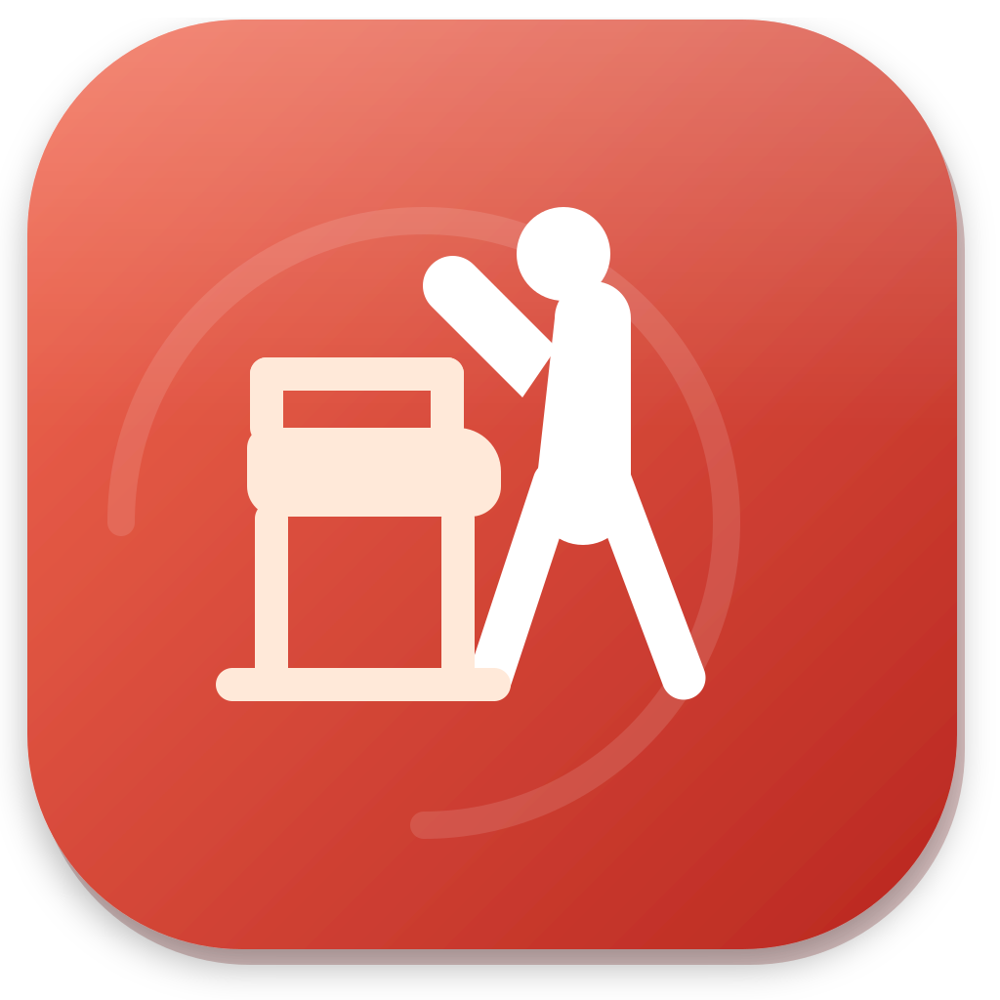
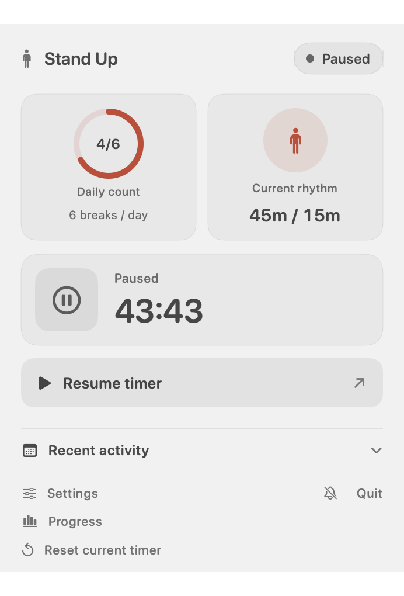
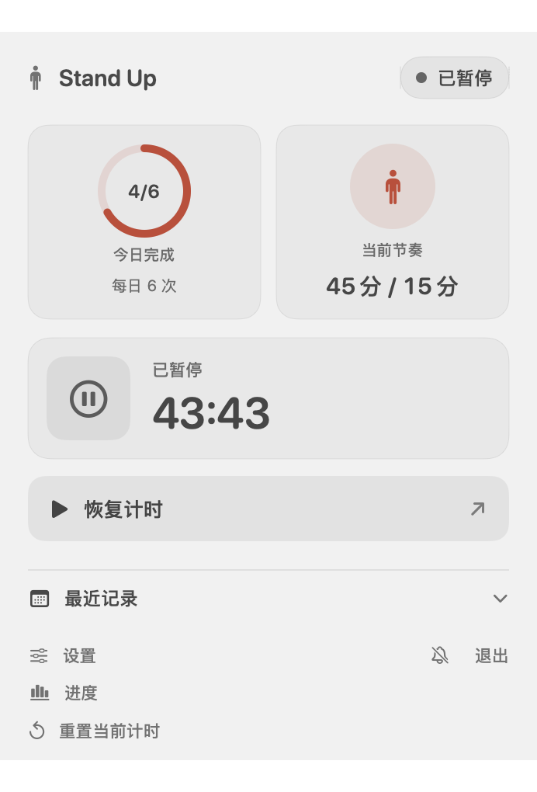
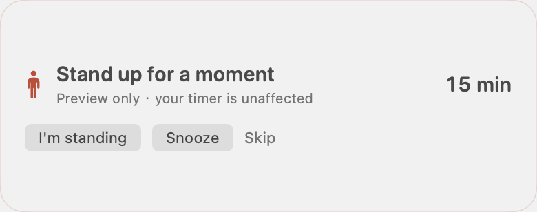
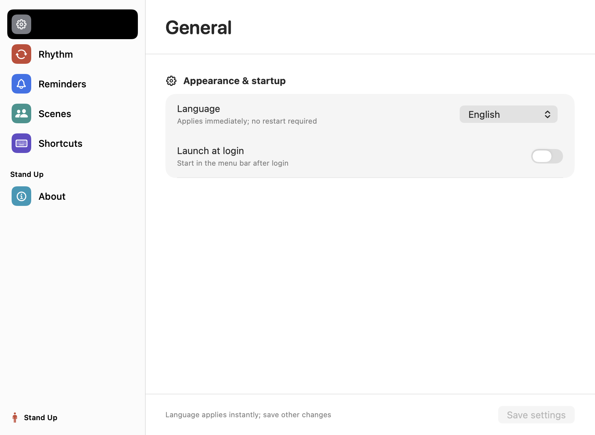
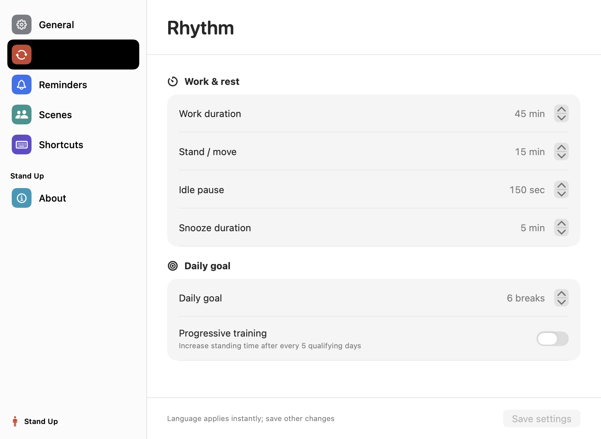
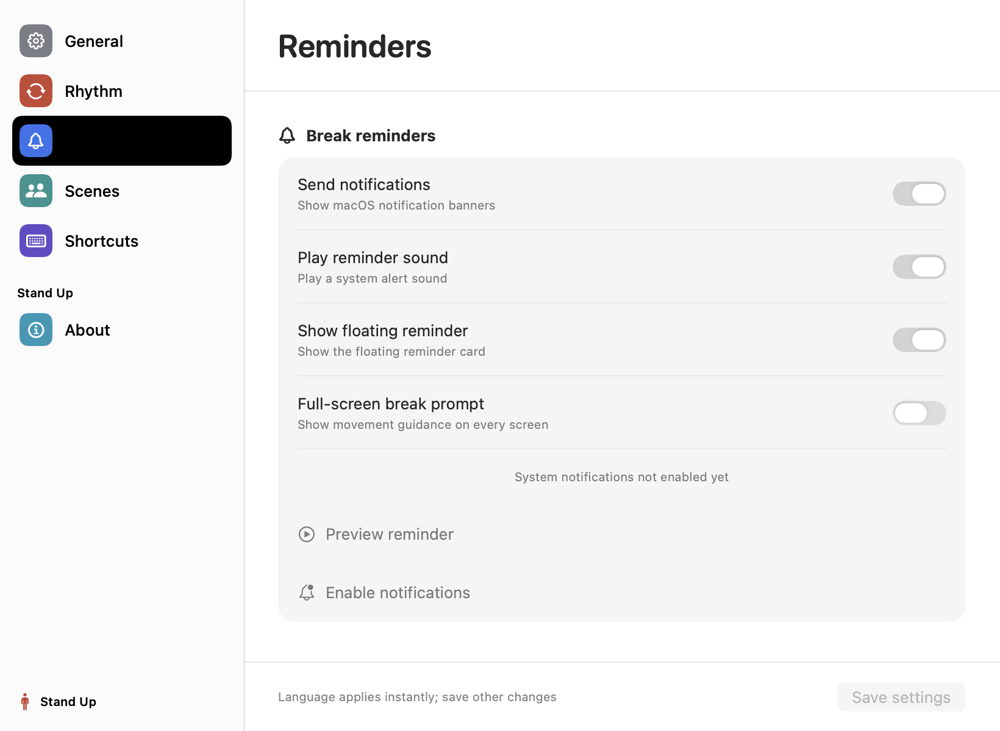
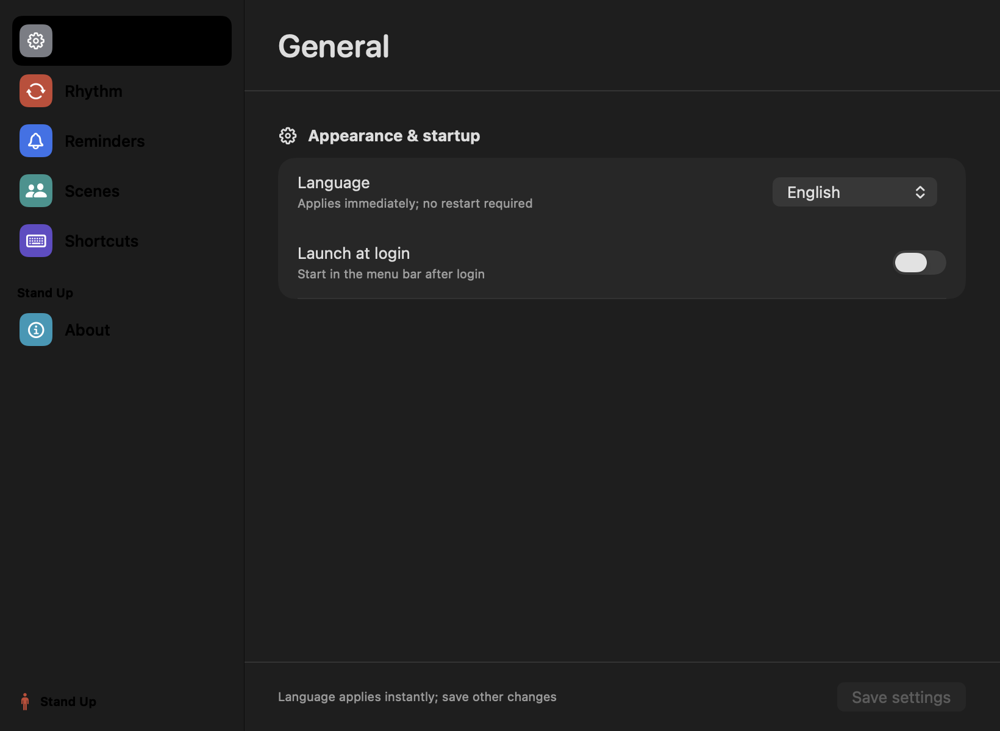
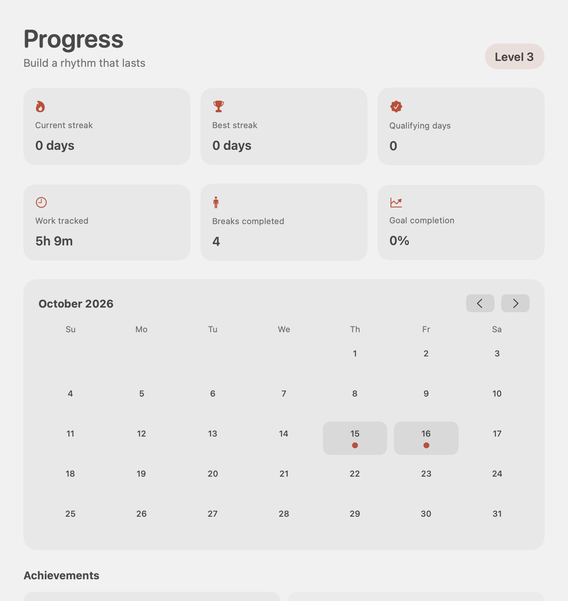

# Stand Up · 起身

<p align="center">
  
</p>

<p align="center">
  <strong>A calm desk rhythm for Mac.</strong><br>
  让每一次起身都发生在合适的时机。
</p>

<p align="center">
  <a href="https://github.com/kbfx1234/stand-up/actions/workflows/test.yml"></a>
  <a href="https://github.com/kbfx1234/stand-up/releases"></a>
  <a href="https://github.com/kbfx1234/stand-up/blob/master/LICENSE"></a>
</p>

Stand Up 是一个原生 macOS 菜单栏应用：累计 **45 分钟有效工作**后提醒你站起来活动 **15 分钟**，然后重新开始下一轮。锁屏、睡眠、长时间无输入和会议场景会被纳入计时判断，让倒计时更接近真实的工作节奏。

> **当前状态 · 0.4.0 preview**
>
> 双语设置、习惯系统、提醒动画和本地进度页已经可用。正式公开 DMG 正在准备 Developer ID 签名与 Apple 公证；在此之前可以从源码构建和本机安装。详见 [发布说明](PUBLISHING.md)。

<p align="center">
  <a href="#安装与运行">Build locally</a> ·
  <a href="https://github.com/kbfx1234/stand-up">Source code</a> ·
  <a href="https://github.com/kbfx1234/stand-up/issues">Report an issue</a>
</p>

## 你真正需要的是一个工作节奏

大多数计时器只会在固定时间弹窗。Stand Up 关心的是这段时间是否真的发生在你的工作桌前：

- 新的键盘或鼠标输入后才开始有效工作计时。
- 默认工作 45 分钟，到点提醒起身；确认后进入 15 分钟站立 / 活动阶段。
- 锁屏、合盖睡眠和系统不可用不会偷偷增加工作时间。
- 短暂离开会保留本轮进度；长时间离开会在回来后开始新一轮。
- 休息预览是隔离的，点击预览里的按钮不会改变正在运行的计时。

## 看得见的节奏

倒计时一直在菜单栏里，面板打开后可以看到今日完成次数、当前坐站节奏、最近记录和下一步动作。界面支持中文与 English，切换后立即生效，不会重置当前计时。

<table>
  <tr>
    <td width="50%"></td>
    <td width="50%"></td>
  </tr>
  <tr>
    <td align="center"><sub>Menu bar dashboard · English</sub></td>
    <td align="center"><sub>菜单栏面板 · 中文</sub></td>
  </tr>
</table>

到点时，提醒卡片提供明确的下一步：开始站立、顺延一次，或跳过本轮。它会淡入、轻微呼吸并做一次短促提示；开启系统“减少动态效果”时自动降低动画。

<p align="center">
  
</p>

<p align="center"><sub>Floating reminder · preview actions never change the running timer</sub></p>

## 三步完成一轮

<table>
  <tr>
    <td width="33%"><strong>01 · Work</strong><br><br>开始工作后，菜单栏显示和页面同步的倒计时。达到工作时长才会进入提醒状态。</td>
    <td width="33%"><strong>02 · Move</strong><br><br>收到系统通知、声音或悬浮卡片后起身。站立阶段单独计时，不会被站着使用电脑打断。</td>
    <td width="33%"><strong>03 · Reset</strong><br><br>休息完成后坐下，点击“我坐下了”，下一轮从新的输入开始。</td>
  </tr>
</table>

## 为程序员工作流设计

| 能力 | 体验 |
| --- | --- |
| **菜单栏倒计时** | 工作、站立和暂停状态用同一份计时状态驱动，菜单栏数字每秒同步。 |
| **三层提醒** | macOS 通知、系统声音和顶部悬浮卡片可以分别开关。 |
| **会议模式** | 手动暂停，或识别 Zoom、Teams、Webex、Slack、FaceTime 和 Google Meet 后智能延后。 |
| **全屏休息提示** | 可选的全屏动作建议，包含走动、喝水、肩颈和远眺。 |
| **快捷键** | `⌥⌘P` 暂停 / 恢复，`⌥⌘S` 立即开始站立阶段。 |
| **习惯系统** | 每日目标、当前 / 最佳连续天数、渐进训练和六类成就。 |
| **本地进度** | 月历、累计工作时间、完成休息次数和目标完成率。 |
| **双语界面** | Follow System、中文、English；语言切换立即生效。 |

## 设置不是一个杂乱的开关列表

设置窗口使用原生 macOS 分栏结构，把节奏、提醒、场景、快捷键和隐私分开。时间和提醒修改保留草稿，点击保存后生效；语言切换即时生效，不会重启或重置倒计时。

<table>
  <tr>
    <td width="50%"></td>
    <td width="50%"></td>
  </tr>
  <tr>
    <td align="center"><sub>Native settings window · English</sub></td>
    <td align="center"><sub>原生设置窗口 · 中文</sub></td>
  </tr>
</table>

更多页面：

<p align="center">
  
  
</p>

<p align="center">
  
</p>

<p align="center"><sub>Light and dark appearance follow macOS</sub></p>

## 让习惯有反馈，而不是只有提醒

Progress 页面把每天的完成情况放在一个自然月里：当前连续、最佳连续、达标天数、累计工作和完成休息都可以快速查看。开启渐进训练后，每完成 5 个达标日会自动提升坐站节奏，升级只影响下一轮，不会改写正在进行的计时。

<p align="center">
  
</p>

<p align="center"><sub>Progress dashboard · calendar, streaks, goals and achievements</sub></p>

## 安装与运行

### 本机安装

需要 macOS 14+ 和 Swift 6 工具链：

```sh
git clone https://github.com/kbfx1234/stand-up.git
cd stand-up
./script/build_and_run.sh --install
```

这会构建 Release 版本并安装到 `/Applications/Stand Up.app`。当前本机包使用 ad hoc 签名，适合开发和个人测试；首次打开其他机器上的测试包时，可能需要在 Finder 中右键选择“打开”。

### 正式公开下载

Developer ID 签名、公证和 GitHub Release 的流程已经写入 [PUBLISHING.md](PUBLISHING.md) 与 [`script/release_public.sh`](script/release_public.sh)。正式 DMG 只有在 `notarytool`、`stapler validate` 和 `spctl` 全部通过后才会上传。

## 隐私与信任边界

- 所有设置、计时状态、历史和习惯数据保存在本机。
- 不读取键盘内容；只使用输入活动来判断是否仍在工作。
- 不需要账号，不接入广告、分析 SDK 或第三方网络服务。
- 通知和悬浮提醒都在本机生成。
- 这是帮助建立工作习惯的工具，不是医疗设备；如果你有疼痛或健康问题，请咨询专业人士。

完整说明见 [PRIVACY.md](PRIVACY.md)。

## 当前版本与下一步

**0.4.0** 已包含菜单栏倒计时、锁屏 / 睡眠判断、三层提醒、会议模式、快捷键、习惯系统、进度页、双语界面和原生设置窗口。

接下来会围绕公开分发继续完善：

- Developer ID Application 签名与 Hardened Runtime。
- Apple notarization、DMG 校验和 GitHub Release。
- 更丰富但可解释的演示、阅读和编译场景判断。
- 根据真实用户反馈调整提醒强度和训练节奏。

## 参与项目

欢迎通过 [Issues](https://github.com/kbfx1234/stand-up/issues) 报告问题或提出功能建议。提交代码前请先阅读 [CONTRIBUTING.md](CONTRIBUTING.md)。

Stand Up is open source under the [MIT License](LICENSE).
